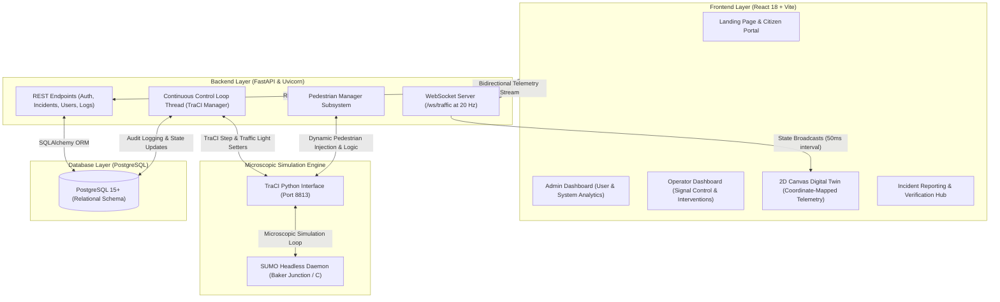

# UrbanFlow: Traffic Signal Optimization Using Digital Twin
## Comprehensive Project Implementation & Technical Review Document

---

## 1. Project Overview & Problem Statement

Urban signalized intersections face persistent traffic congestion due to static, fixed-time signal switching schedules. These inflexible timing cycles cause unnecessary vehicle idling on clear approaches, heightened tailpipe emissions, increased fuel consumption, and significant delays for emergency vehicles.

**UrbanFlow** presents a unified **Cyber-Physical Digital Twin (DT)** framework for smart city traffic intersection management. By pairing high-fidelity microscopic simulation with real-time bidirectional telemetry and adaptive signal control algorithms, the system creates a virtual twin that mirrors and optimizes physical intersection dynamics.

### Primary Objectives:
- **High-Fidelity Virtual Synchronization**: Simulate multi-modal urban traffic in real time using SUMO (Simulation of Urban MObility) and TraCI.
- **Adaptive Signal Timing (ATSC)**: Dynamically adjust signal phase durations based on instantaneous queue depths and vehicle halting counts.
- **2D Web Digital Twin Visualization**: Map simulation physics into a browser-based, high-refresh 2D canvas displaying individual vehicles, signal states, and crosswalks.
- **Human-in-the-Loop Control**: Provide traffic controllers with real-time manual overrides and automated fail-safe returns.
- **Incident & Fleet Administration**: Offer multi-role dashboards for System Administrators, Traffic Controllers, and Citizens.

---

## 2. System Architecture

UrbanFlow uses a three-tier decoupled architecture:



---

## 3. Technology Stack

| Layer | Component / Tool | Role in System |
| :--- | :--- | :--- |
| **Micro-Simulation** | SUMO 1.20+ & TraCI | Generates road networks, vehicles, routing, car-following models, and traffic light links. |
| **Backend Framework** | Python 3.10+ / FastAPI | Provides asynchronous RESTful APIs and WebSocket multiplexing. |
| **Web Server** | Uvicorn (ASGI) | Manages non-blocking concurrent request handling and telemetry loops. |
| **Database & ORM** | PostgreSQL & SQLAlchemy | Stores user credentials, intersection configurations, signal states, and system audit logs. |
| **Security & Auth** | Passlib (Bcrypt) & Python-Jose | Encrypts passwords, validates tokens, and drives first-time login onboarding. |
| **Frontend Framework**| React 18 & Vite | Fast, reactive Single Page Application (SPA) architecture. |
| **Graphics Context** | HTML5 Canvas 2D WebGL Context | Renders sub-pixel vehicle vectors, heading rotations, and headlights at 60 FPS. |
| **UI Design System** | Tailwind CSS & Lucide Icons | Clean SaaS dashboard interface with responsive controls. |

---

## 4. Road Network & Junction Topology

The primary simulated node is **Baker Junction (Junction `C`)**:
- **Intersection Position**: Origin centered at `(300, 300)` on the SUMO Cartesian grid.
- **Geometry**: 4-legged intersection:
  - **North Leg (`N2C` / `C2N`)**: Inbound and outbound corridors.
  - **East Leg (`E2C` / `C2E`)**: Inbound and outbound corridors.
  - **South Leg (`S2C` / `C2S`)**: Inbound and outbound corridors.
  - **West Leg (`W2C` / `C2W`)**: Inbound and outbound corridors.
- **Lane Specifications**: Road edge width of `16.0m` (two lanes per direction at `8.0m` total width).
- **Traffic Light Configuration**: 16 controlled signal links regulating left, through, and right-turn movements.

### Multi-Class Vehicle Fleet Profiles
UrbanFlow simulates a heterogeneous vehicle fleet with customized rendering dimensions:

| Class Type | Color Representation | Canvas Length | Velocity Profile & Priority |
| :--- | :--- | :--- | :--- |
| **Ambulance** | Pure White (`#ffffff`) | 28 px | Emergency high-speed vehicle with siren effects |
| **Bus** | Transit Red (`#ef4444`) | 40 px | Public transport carrier with longer stopping distances |
| **Heavy Truck** | Industrial Orange (`#f97316`) | 44 px | Commercial freight with lower acceleration |
| **SUV** | Cyan (`#06b6d4`) | 26 px | Medium-sized consumer transport |
| **Passenger Car**| Dynamic Pastel Palette | 22 px | Standard personal vehicles |
| **Auto-Rickshaw**| Green (`#22c55e`) | 18 px | Three-wheeled urban transport |
| **Motorcycle** | Gold / Yellow (`#eab308`) | 14 px | Agile two-wheeler maneuvers |

---

## 5. Adaptive Signal Control & Optimization Logic

### 4-Phase Single-Direction Protected Green Cycle
Traffic follows a single-direction green sequence:
$$\text{North Green} \longrightarrow \text{East Green} \longrightarrow \text{South Green} \longrightarrow \text{West Green}$$

Each phase transition includes a **3-second yellow clearance interval** (`yyyyrrrryyyyrrrr`) to ensure intersection clearance.

### Queue-Length Dynamic Extension Algorithm
In `AUTO` mode, the system checks halting vehicles before switching phases:

```python
# TraCI queue interrogation
q = traci.lane.getLastStepHaltingNumber(approach_lane)
```

1. **Base Green Time**: Default is **12 seconds**.
2. **Adaptive Extension**: If halting vehicles exceed a threshold ($q > 3$), extra green time is granted:
   $$\text{Duration} = \min\big(12 + (q - 3) \times 2,\, 25\big)\quad [\text{seconds}]$$
3. **Threshold Bounds**:
   - Minimum guaranteed green: **12 seconds**
   - Maximum safety ceiling: **25 seconds**
   - Step extension rate: **2 seconds per halting vehicle over 3**
4. **Audit Trail**: Every dynamic extension is recorded in the `system_logs` database with queue depth, timestamp, and duration.

### Operator Override & Fail-Safe Mechanics
- Operators can force an emergency green state on any leg.
- Overrides feature an active countdown timer.
- Once the timer reaches zero, the system reverts safely to the automated cycle without disrupting the phase state machine.

---

## 6. Digital Twin Canvas: Coordinate Mapping & Telemetry

### Y-Axis Inversion Layer
SUMO positions objects on a standard Cartesian plane ($Y$ increases upward), while HTML5 Canvas places $(0, 0)$ at the top-left ($Y$ increases downward). UrbanFlow applies an inversion transform:

$$\begin{aligned}
X_{\text{canvas}} &= 300 + (X_{\text{sumo}} - 300) \times 5 \\
Y_{\text{canvas}} &= 300 - (Y_{\text{sumo}} - 300) \times 5
\end{aligned}$$

Using this scaling factor with the 8.0-meter road widths keeps vehicles centered on canvas lanes through 90-degree turns without snapping or jitter.

### High-Frequency WebSocket Telemetry
Telemetry streams over `/ws/traffic` at **20 Hz (50ms cycles)** with a TraCI step size of `0.08s`:
- Vehicle positions, rotation angles, speeds, and waiting durations.
- Active signal strings (e.g., `GGGGrrrrrrrrrrrr`).
- Approach queue badges overlaid directly onto incoming lanes.
- Pedestrian statuses (waiting at curb, crossing, completed).

---

## 7. Pedestrian Simulation Subsystem

The `PedestrianManager` adds pedestrian crossing dynamics to Junction C:
- **Zebra Crossings**: North ($y=314$), South ($y=286$), East ($x=314$), West ($x=286$).
- **Stochastic Group Generation**: Generates groups of 1 to 4 pedestrians every 10–25 seconds.
- **Pedestrian Walking Dynamics**: Realistic walking speeds between $1.0\text{ m/s}$ and $1.6\text{ m/s}$.
- **Safety Interlocking**: Pedestrians cross only during compatible red phases on opposing vehicular approaches.

---

## 8. Database Architecture & Relational Entities

The system uses a PostgreSQL schema (`backend/schema.sql`):

```
users (user_id, name, email, password, role, is_first_login, security_question, ...)
  │
  ├──< operatorassignment (assignment_id, operator_id, intersection_id, assigned_date)
  │
  ├──< manualoverride (override_id, operator_id, signal_id, reason, start_time, ...)
  │
  └──< incident (incident_id, reported_by, intersection_id, type, description, status)

intersections (intersection_id, intersection_name, location, latitude, longitude, status)
  │
  ├──< trafficsignal (signal_id, intersection_id, current_state, green_time, mode, ...)
  │
  └──< trafficdata (traffic_id, intersection_id, vehicle_count, queue_length, waiting_time, ...)
```

### Table Definitions:
1. **`users`**: Role-based profiles (`ADMIN`, `OPERATOR`, `PUBLIC`), Bcrypt password hashes, and first-login tracking.
2. **`intersections`**: Physical junction registry with geographic coordinates.
3. **`trafficsignal`**: Real-time signal states, split allocations, and operational modes (`AUTO`, `MANUAL`).
4. **`trafficdata`**: Historical metrics (vehicle volume, average wait, density, congestion indices).
5. **`manualoverride`**: Audit records of human-initiated overrides.
6. **`incident`**: Crowdsourced and operator incident tickets with lifecycle tracking (`PENDING`, `VERIFIED`, `RESOLVED`).
7. **`system_logs`**: System event logs and administrative audits.

---

## 9. User Roles & Security Workflows

### Role-Based Access Control (RBAC)
- **System Administrator**: Manages user accounts, assigns junctions to operators, reviews system audit logs, and monitors citywide infrastructure.
- **Traffic Controller (Operator)**: Monitors real-time junction telemetry, issues priority overrides, and verifies incident reports.
- **Citizen (Public)**: Views general traffic statuses, submits incident reports, and navigates local road conditions.

### Onboarding & Password Recovery
1. **Operator Provisioning**: Admins create operator accounts using only their name and email.
2. **Local SMTP Simulator**: Automatically generates temporary credentials and writes them to `backend/sent_emails.txt`.
3. **Forced First-Login Wizard**: Prompts operators on first login to set a permanent password and select a security question.
4. **Self-Service Password Reset**: Multi-step identity recovery backed by security questions.

---

## 10. Performance Evaluation: Baseline vs. Digital Twin

| Performance Metric | Fixed-Time Signal Plan (Baseline) | UrbanFlow Digital Twin (Adaptive) |
| :--- | :--- | :--- |
| **Control Logic** | Static 42s Green / 3s Yellow splits | Dynamic (12s base, queue-extended to 25s) |
| **Approach Queue Clearing** | Prone to spillover under traffic surges | Dynamically extended green clears excess queues |
| **Low-Demand Green Allocation** | Wastes time serving empty lanes | Rapid phase transitions cut down idle delays |
| **Emergency Priority Response** | None; emergency vehicles wait in queue | Manual override provides direct green paths |
| **Situational Awareness** | Periodic on-site inspections | Live 2D Digital Twin telemetry at 20 Hz |
| **Safety Integration** | Uncoordinated crossing phases | Interlocked pedestrian crosswalk phases |

---

## 11. Recommended Review Paper / Report Outline

1. **Title & Abstract**: Highlighting cyber-physical synchronization, SUMO TraCI, and adaptive traffic signal control.
2. **Introduction**:
   - Urban congestion challenges and environmental impacts.
   - Limitations of conventional fixed-time controllers.
   - Emergence of Digital Twins in intelligent transportation.
3. **Related Work**:
   - Survey of adaptive systems (SCOOT, SCATS).
   - Reinforcement learning vs. rule-based heuristic control in SUMO.
   - WebGL and Canvas-based telemetry visualization.
4. **Proposed Digital Twin Architecture**:
   - Physical-to-virtual data pipeline (SUMO $\leftrightarrow$ TraCI $\leftrightarrow$ FastAPI).
   - Inverted Cartesian coordinate mapping layer.
5. **Adaptive Signal Optimization Model**:
   - Queue-length extraction formulas.
   - Dynamic green-time allocation algorithms.
   - Safety yellow clearance intervals and pedestrian interlocking.
6. **Experimental Implementation & Results**:
   - Simulation setup for Junction C (Baker Junction).
   - Multi-class fleet distributions and arrival rates.
   - Comparative delay and queue performance analyses.
7. **Conclusion & Future Directions**:
   - Summary of key findings and efficiency gains.
   - Multi-intersection arterial coordination.
   - Deep Reinforcement Learning (PPO/DQN) integration.
   - Automated V2X emergency vehicle preemption.
