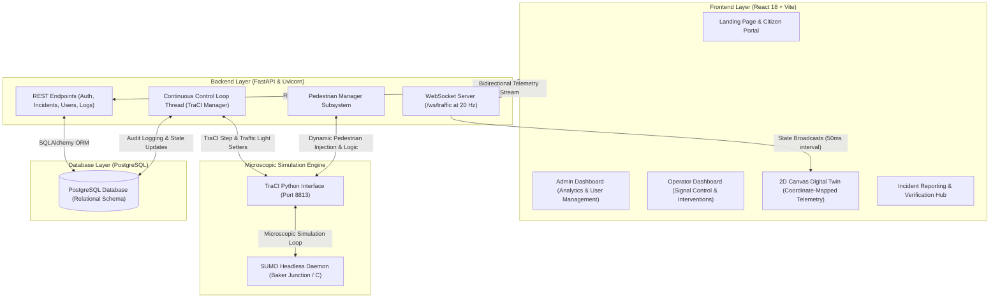

# UrbanFlow: Traffic Signal Optimization Using Digital Twin

[](https://fastapi.tiangolo.com/)
[](https://react.dev/)
[](https://eclipse.dev/sumo/)
[](https://www.postgresql.org/)
[](https://vitejs.dev/)

**UrbanFlow** is a full-stack, cyber-physical **Digital Twin (DT)** system designed for adaptive traffic signal optimization in smart cities. By integrating microscopic traffic simulation (**Eclipse SUMO**) via Python's **TraCI**, a high-performance **FastAPI** backend, and a real-time **React (Canvas 2D/WebGL)** dashboard, UrbanFlow simulates, visualizes, and optimizes urban intersections in real time.

---

## Architecture Overview



---

## Key Features

### 1. Real-Time 2D WebSocket Digital Twin Canvas
- **High-Frequency Telemetry**: WebSocket stream (`/ws/traffic`) broadcasting vehicle positions, heading angles, speeds, and queues at 20 Hz (50ms intervals).
- **Y-Axis Coordinate Inversion Layer**: Resolves coordinate differences between SUMO's Cartesian system and HTML Canvas:
  $$\text{Canvas}_X = 300 + (X - 300) \times 5 \qquad \text{Canvas}_Y = 300 - (Y - 300) \times 5$$
  Aligned with road widths ($8.0\text{m}$) for smooth Bezier curved turns without artificial snapping.
- **Heterogeneous Vehicle Fleet**: Dynamic vector rendering with realistic color palettes, tire offsets, headlights, and dimensions:
  - Ambulances (emergency priority), Buses, Heavy Trucks, SUVs, Passenger Cars, Auto-Rickshaws, and Motorcycles.
- **Lane Queue Badges**: Floating vehicle counts overlaid directly on approach lanes.

### 2. Adaptive Traffic Signal Control (ATSC)
- **4-Phase Single-Direction Protected Cycle**: Cycles one approach green at a time (**North** &rarr; **East** &rarr; **South** &rarr; **West**) using a 16-link junction controller with a 3-second yellow clearance interval.
- **Queue-Responsive Green Extension**: Dynamically extracts halting queues via TraCI (`getLastStepHaltingNumber`). If a lane has $> 3$ halting vehicles:
  $$\text{Green Duration} = \min(12 + (q - 3) \times 2,\, 25)\quad [\text{seconds}]$$
  Default base green is **12 seconds** (up to a **25-second** safety cap).
- **Emergency Priority Overrides**: Operators can force any direction green. Overrides feature live countdowns and automatically release back to `AUTO` mode when completed.
- **Pedestrian Safety Interlocking**: Integrated `PedestrianManager` coordinates crossing groups (1–4 pedestrians) at designated zebra crosswalks during compatible red vehicular intervals.

### 3. Multi-Role User Portals & Incident Hub
- **Role-Based Access Control (RBAC)**:
  - **System Administrator**: User management, junction assignments, system analytics, and audit logging.
  - **Traffic Operator**: Real-time signal overrides, junction monitoring, and incident verifications.
  - **Public Citizen**: Incident reporting (accidents, hazards, roadblocks, speed violations) with status tracking (`PENDING`, `VERIFIED`, `RESOLVED`).
- **Security & Password Workflows**:
  - Simplified operator provisioning (temporary password generation logged via local SMTP simulator to `sent_emails.txt`).
  - Viewport-blocking **Forced First-Login Wizard** for initial password setup.
  - Self-service **Forgot Password Wizard** with security questions.

---

## Project Structure

```
├── backend/
│   ├── sumo_files/              # Compiled SUMO network configs
│   │   ├── sumo.edg.xml         # Road edge geometry
│   │   ├── sumo.net.xml         # Compiled junction network
│   │   ├── sumo.nod.xml         # Node definitions
│   │   ├── sumo.rou.xml         # Vehicle routes and flows
│   │   └── sumo.sumocfg         # SUMO simulation configuration
│   ├── database.py              # SQLAlchemy database engine and session
│   ├── generate_sumo_files.py   # SUMO network node, edge, and flow compiler
│   ├── main.py                  # FastAPI app, REST routes, WebSockets, control loops
│   ├── pedestrian_manager.py    # Crosswalk logic and pedestrian simulation
│   ├── requirements.txt         # Python dependencies
│   ├── schema.sql               # PostgreSQL relational database schema
│   ├── sent_emails.txt          # Local SMTP simulator log
│   ├── simulation.py            # TraCI runner and coordinate telemetry
│   └── test_simulation.py       # TraCI environment verification test
├── src/
│   ├── AdminDashboard.jsx       # Admin portal, user management & system metrics
│   ├── App.jsx                  # Main routing, incident hub & auth modal flows
│   ├── LandingPage.jsx          # Public landing portal
│   ├── OperatorDashboard.jsx    # Traffic controller signal override station
│   ├── SimulationCanvas.jsx     # High-performance 2D Canvas Digital Twin
│   └── main.jsx                 # React root entry point
├── PROJECT_REPORT_REVIEW_PAPER.md # In-depth technical report & review paper
└── package.json                 # Frontend dependencies and scripts
```

---

## Getting Started

### 1. Prerequisites
- **Python 3.10+**
- **Node.js 18+** & **npm**
- **PostgreSQL 14+**
- **Eclipse SUMO 1.20+**: Ensure `SUMO_HOME` is configured in your system environment variables (e.g., `C:\Program Files (x86)\Eclipse\Sumo`).

---

### 2. Database Configuration
1. Open PostgreSQL (via psql or pgAdmin) and create a database named `urbanflow`:
   ```sql
   CREATE DATABASE urbanflow;
   ```
2. Initialize tables and seed default users:
   ```powershell
   psql -U postgres -d urbanflow -f backend/schema.sql
   ```
   *(Default accounts: Admin: `admin@gmail.com` / `admin123`, Operator: `operator@gmail.com` / `operator123`, Citizen: `citizen@gmail.com` / `citizen123`)*

---

### 3. Backend Setup
1. Navigate to the backend directory and activate a virtual environment:
   ```powershell
   cd backend
   python -m venv venv
   .\venv\Scripts\activate
   ```
2. Install Python dependencies:
   ```powershell
   pip install -r requirements.txt
   ```
3. Generate and compile SUMO network files:
   ```powershell
   python generate_sumo_files.py
   ```
4. Start the FastAPI server:
   ```powershell
   python -m uvicorn main:app --reload --port 8000
   ```
   *FastAPI Swagger documentation will be available at `http://localhost:8000/docs`.*

---

### 4. Frontend Setup
1. Open a new terminal in the project root directory:
   ```powershell
   npm install
   ```
2. Launch the Vite development server:
   ```powershell
   npm run dev
   ```
3. Open your browser and navigate to `http://localhost:5173`.

---

## License

This project is developed for academic research and educational purposes in intelligent traffic optimization and digital twin engineering.
